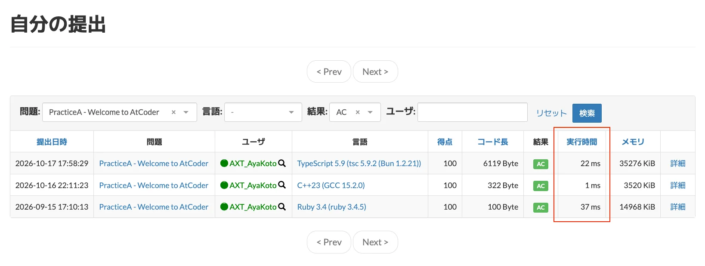
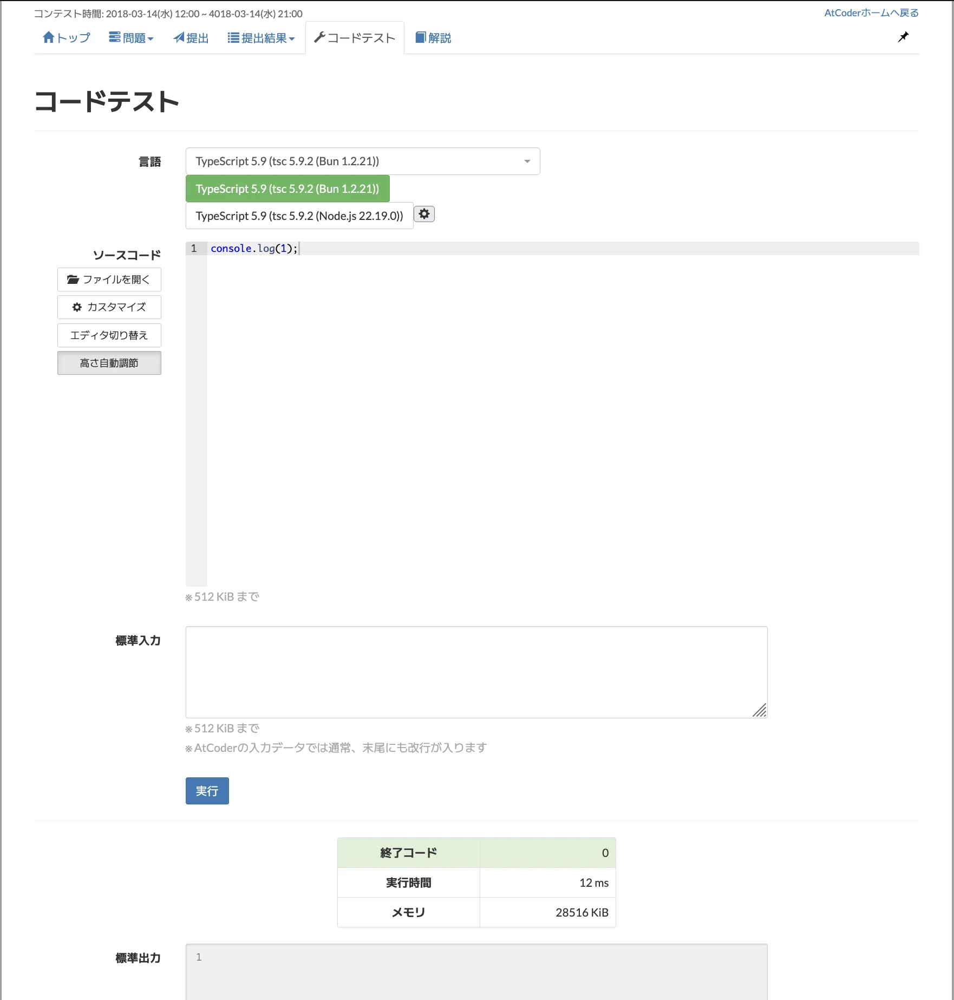
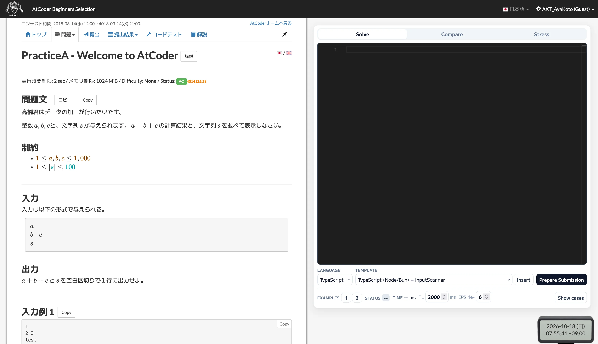
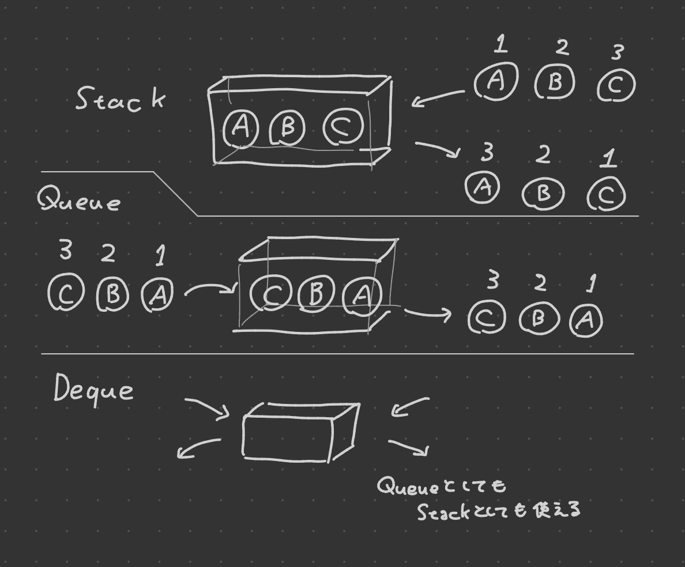
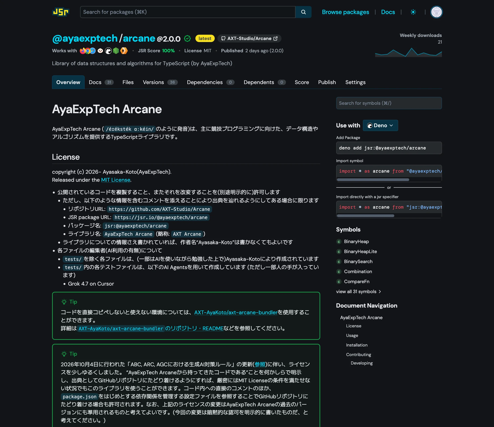
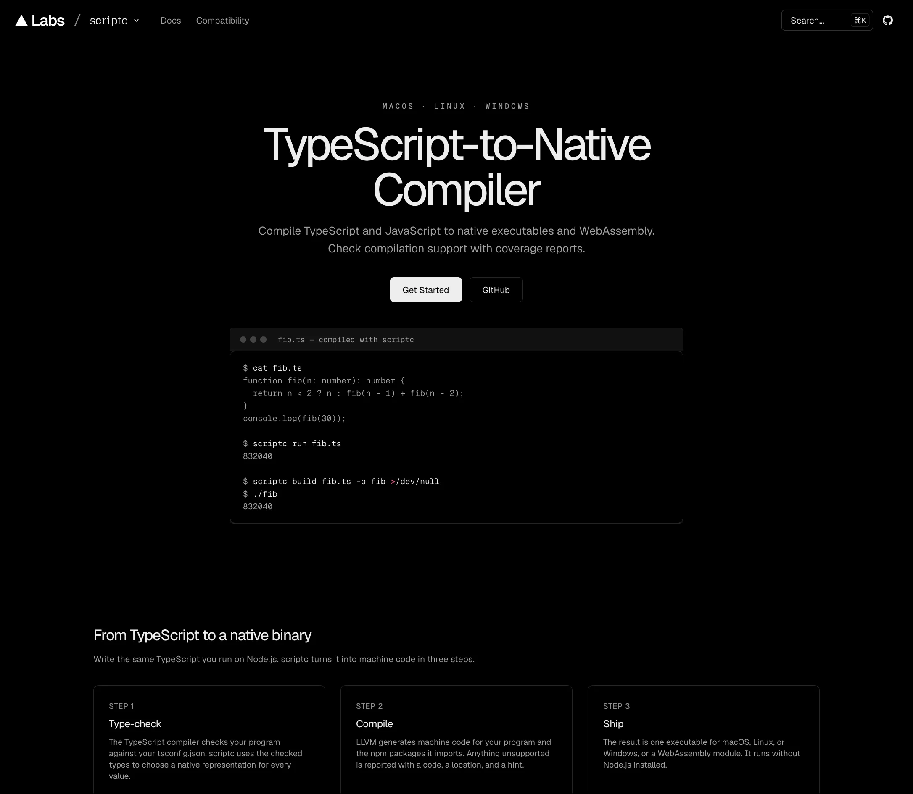
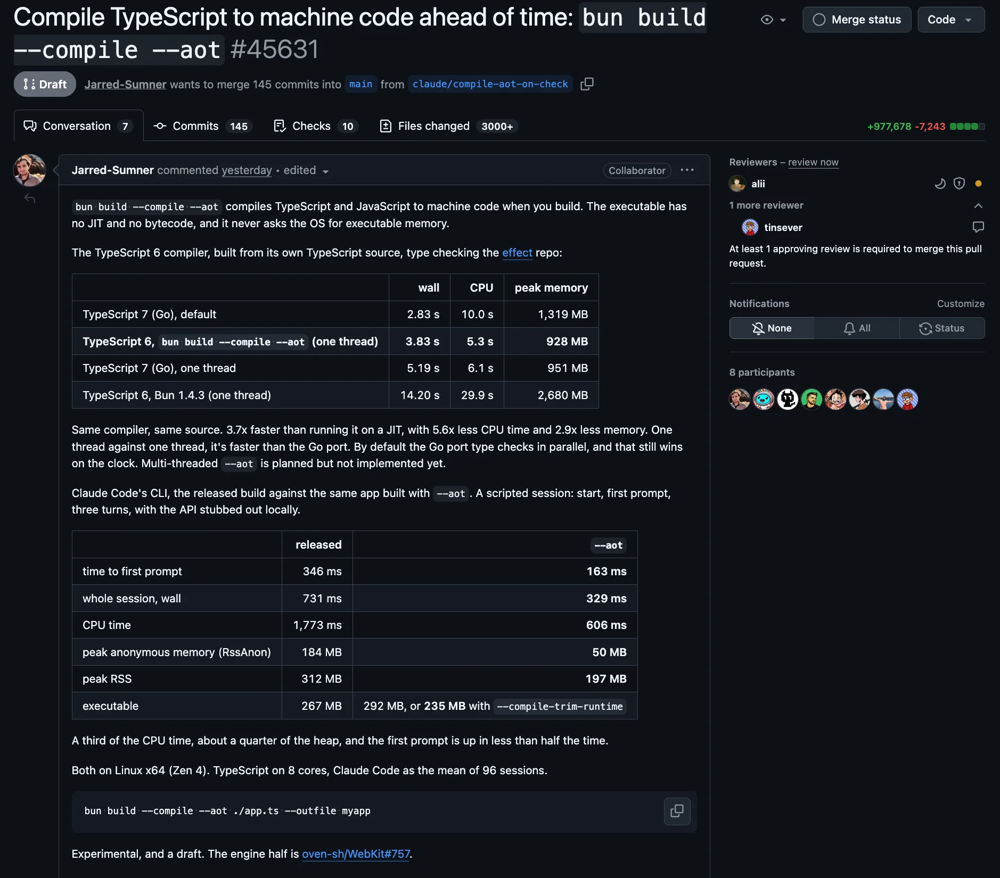
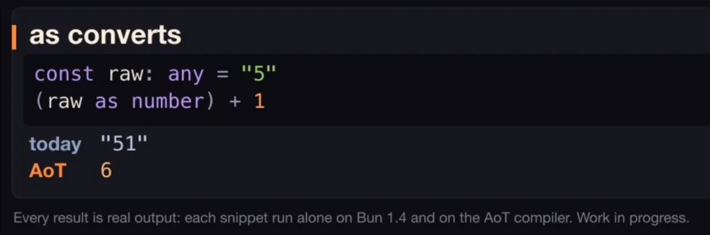

<!-- presen-it! slide-break (center-x=true) -->

# JavaScriptで競技プログラミングをする

2026-10-19 ― Ayasaka-Koto (AyaExpTech) @Ginza.js#12

_Rehearsal Edit: 2026-10-18 @ZEN大学プレゼン同好会オフ会_

<!-- presen-it! slide-break -->

<!-- presen-it! column-break -->

## Rehearsal Edit向け注意

<!-- presen-it! slide-break -->

## Rehearsal Edit向け注意 ― 経緯

本来は明日(2026-10-19)開催の [Ginza.js#12](https://ginzajs.connpass.com/event/404171/) というプログラミング言語コミュニティのイベントで私が話す内容
ゆえに、……<!-- presen-it! reveal (at=1) -->

- 想定聴者が「JavaScript・TypeScriptプログラミングができる人間」です<!-- presen-it! reveal (at=2) -->
- 非プログラマーは知らないような専門用語を容赦なく使います<!-- presen-it! reveal (at=3) -->
- もしあなたが非プログラマーなら、ほぼ間違いなく置いてけぼりになるでしょう
    - たぶん「日本語でおｋ」という感想を抱く人がほとんどでしょう
- ~~スライドの公開が明日以降になりますが許してください~~

<!-- presen-it! slide-break -->

## Rehearsal Edit向け注意 ― このプレゼンの楽しみ方

<!-- presen-it! reveal (at=1) -->

- “こんな世界もあるんだなぁ”と眺めてみる
    - 私はこれから、プログラマーコミュニティという特殊環境に寄せに行ったプレゼンをします
    - こういう話を面白がるようなコミュニティが世の中にはあるんだなぁ、と思いながら聞いてください<!-- presen-it! reveal (at=2) -->
- 話の構造だけでも掴んでみる
    - “オフチョベットしたテフをマブガッドしてリットにする”からも、“マブガッド”が何らかの動作であることはわかりますよね
    - そういう構造だけでも掴んでみる、と試みるのはそれはそれで面白いかもしれません
    - 構造さえ掴んでキーワードを逃さなければ、あとでAIに聞くなどしてより深く理解できるかもね。できたらすごい

<!-- presen-it! reveal (at=3) -->

とはいえ、なんとなーーくでも概要知って楽しんでくれたら嬉しいので、最低限の事前知識だけ説明させてください

<!-- presen-it! slide-break -->

## Rehearsal Edit向け注意 ― 重要な概念・キーワードの説明 (1)

**プログラミング言語は複数ある**
**同じ課題の解決に対していろんな書き方ができる**

<!-- presen-it! reveal (at=1) -->

- 右の2つのコードは違う言語だが同じことをしている
    - $1$以上$N$以下の整数の合計を求める
    - 見た目がちょっとずつ違いますよね
        - `let`, `range`, `;`, `:`, `print`, `{}`, ……<!-- presen-it! reveal (at=2) -->
- いろんな言語があるんです
    - JavaScript、TypeScript、C++、Python、……

<!-- presen-it! column-break -->

<!-- presen-it! reveal (at=1) -->

TypeScript

```ts
let sum = 0;
for (let i = 1; i <= N; i++) {
    sum = sum + i;
}
console.log(sum);
```

Python

```py
sum = 0
for i in range(1, N + 1):
    sum = sum + i
print(sum)
```

<!-- presen-it! slide-break (center-x=true) -->

## Rehearsal Edit向け注意 ― 重要な概念・キーワードの説明 (2)

**プログラミング言語によって、処理速度が違う**

<!-- presen-it! reveal (at=1) -->



<!-- presen-it! reveal (at=2) -->

同じ動作をするプログラムでも、言語によって実行にかかる時間や実行自体の速度が違う

<!-- presen-it! slide-break -->

## Rehearsal Edit向け注意 ― 重要な概念・キーワードの説明 (3)

**プログラミングの世界には、「ライブラリ」という“道具箱”的なものがある**

<!-- presen-it! reveal (at=1) -->

- 同じようなプログラムを書くなら使いまわしたい<!-- presen-it! reveal (at=2) -->
- なので、プログラムを使いまわしやすいようにまとめてインターネット上とかで公開したりする<!-- presen-it! reveal (at=3) -->
- この「**使いまわしやすいようにプログラムをまとめたもの**」を「**ライブラリ**」と呼ぶ<!-- presen-it! reveal (at=4) -->
- ライブラリは自分で作ることもできる……が、そこそこめんどくさい<!-- presen-it! reveal (at=5) -->
- **ライブラリは言語ごとにつくる**もので、**他言語向けのライブラリを使い回すことはできない**

<!-- presen-it! slide-break -->

## Rehearsal Edit向け注意 ― Are you ready?

- とりあえずこの3つを知っておけば、概要(とくに後半)は掴めるはず
    - プログラミング言語は色々ある
    - 言語ごとに処理速度が違う
    - 「ライブラリ」というプログラムを使い回す仕組みがある<!-- presen-it! reveal (at=1) -->
- Are you ready?
    - 各々好きに楽しんでくれ

<!-- presen-it! slide-break -->

ここから本編

<!-- presen-it! slide-break -->

## 諸注意

- タイトルでJavaScriptって言ってますが、実際私が書いてるのはTypeScriptです
    - 「Ginza.**js**」なのでJavaScriptって書きました
    - JavaScriptって言ったりTypeScriptって言ったりしますが、適宜読み替えてください

<!-- presen-it! slide-break -->

## 自己紹介

綾坂こと (Ayasaka-Koto)

- 所属: ZEN大学 2年生
- AtCoder (Algo) Highest Rate <b style="color:#00C0C0">1238</b><!-- presen-it! reveal (at=1) --> **←今日はこれの話**<!-- presen-it! reveal -->
- 趣味: 音ゲー, Vtuber(hololive)
- Website: https://axtech.dev/

<!-- presen-it! column-break (center-x=true) -->


<!-- presen-it! slide-break -->

## 競技プログラミング

この世界には「競技プログラミング」というものがあります
(名前だけ知ってるけどやったことない、みたいな人もいそう)

> 決められた条件のもとで与えられた問題、課題をプログラミングを用いて解決し、その過程や結果を競うもの ……(後略)
> (https://info.atcoder.jp/overview/about/competitive)

- 問題が出て、それを解くプログラムを書く速さとか正確さを競う頭脳スポーツ
- コンテストサイトの1つに「AtCoder」がある<!-- presen-it! reveal (at=1) -->
- 2年ちょっと前にこれを知った私「面白そうじゃん」

<!-- presen-it! slide-break -->

## TypeScript × AtCoder ?

- 色んな言語が使える
    - [AtCoderで使用出来る言語とライブラリの一覧 - 2025/10 (img.atcoder.jp)](https://img.atcoder.jp/file/language-update/2025-10/language-list.html)<!-- presen-it! reveal (at=1) -->
    - JavaScript・TypeScriptも対応している
        - Node.js 22.19.0, Deno 2.4.5, Bun 1.2.21が使える<!-- presen-it! reveal (at=2) -->
- 当時の私「**JavaScript(TypeScript)で競プロ、やろう！**」<!-- presen-it! reveal (at=3) -->
    - この判断で私は茨の道を歩むことに……<!-- presen-it! reveal (at=4) -->
    - 今日はその“茨の道を歩きました”という苦労話から始めようと思います

<!-- presen-it! slide-break -->

<!-- presen-it! column-break -->

## その1: 環境構築

<!-- presen-it! slide-break -->

## 最初どうしてた？

AtCoderには「コードテスト」というページがあり、ここに直接コードを書いていた
<!-- presen-it! reveal (at=1) -->

- メリット
    - AtCoderの判定サーバーでコードを実行してくれる
    - 事前準備なしですぐ使える<!-- presen-it! reveal (at=2) -->
- デメリット
    - コード実行には時間がかかる (10秒くらい)
    - エディタ部分はそこまでリッチじゃない
        - Syntax Highlightingはある
        - IntelliSenseも型チェックもない

<!-- presen-it! reveal (at=3) -->

割とすぐ「さすがに不便だな……」と思った

<!-- presen-it! column-break -->

<!-- presen-it! reveal -->



<!-- presen-it! slide-break -->

## ローカル提出環境を整えるのは難しい

間違いなく便利にはなるが……
<!-- presen-it! reveal (at=1) -->

- 別に公式に問題取得やコード提出ができるAPIがあるわけではない
    - どのツールもだいぶ強引に解決している……らしい<!-- presen-it! reveal (at=2) -->
- 主流ツールの[`oj`](https://github.com/online-judge-tools/oj)は2年以上更新なし
    - AtCoder含む一部サービスに対しては正常に動作しなくて、有志パッチが必要らしい
    - いずれにせよ通常よりも一段複雑な環境構築をやることになる
    - 新興ツールもまだ発展途上

<!-- presen-it! reveal (at=3) -->

`pnpm`とかですらちょっときついなと思ってる人間にそんな環境構築できるわけないだろ！
(できるならさっさとやるべきではあると思う)

<!-- presen-it! slide-break -->

## 解決策

<!-- presen-it! reveal (at=1) -->

ブラウザ拡張機能を作りました！！

**AtCoder In-Browser Playground**
(GitHub: [`AXT-Studio/AtCoder-InBrowser-Playground`](https://github.com/AXT-Studio/AtCoder-InBrowser-Playground))

- 問題ページにエディタとテスト実行のためのUIを追加
    - エディタはMonaco Editor (VSCodeのベース)
        - 割とVSCodeに近い感じで使える
        - JS/TSはIntelliSenseも対応(?!)
    - テスト実行はWebAssemblyでいい感じに

<!-- presen-it! column-break -->



<!-- presen-it! slide-break -->

## 得たもの

**拡張機能を入れるだけである程度まともなコード編集・実行環境が用意される**状態が確保された

- とりあえず十分戦えるだけの機能は持っている
- コードテストという不自然の極みみたいな環境を使わなくていい
- 面倒な環境構築から一旦逃げることができる

<span style="opacity:.6;font-size:.85em">注: AIBPは近いうちにリメイクするかもしれません 他のサイトにも対応したかったりソースコードが複雑だったり改善点がないわけではなくて……</span>

書く環境は整ったので、いよいよ本格的に問題に挑戦！

<!-- presen-it! slide-break -->

<!-- presen-it! column-break -->

## その2: ライブラリ整備

<!-- presen-it! slide-break -->

## 競技プログラミングの壁

**計算量の見積もりによる適切なアルゴリズム・データ構造の選択**

- ある難易度帯から、「与えられる量のデータを十分処理できるプログラムを書く」ことが求められる
    - そのためにアルゴリズムの計算量を見積もったりする
    - 近い文脈で$O(n^2)$みたいなのを見たことがある人がいれば、それです

<!-- presen-it! slide-break -->

## 大問題

- **JS/TS標準にはない「十分高速なアルゴリズム・データ構造」が多数存在する**
- **ライブラリはあるにはあるが、コンテスト本番で使うには不安要素がある**

<!-- presen-it! slide-break -->

## JS/TS標準にないやつ

- 平衡二分探索木
    - C++の`std::set`, `std::map`、Javaの`TreeSet`など
    - Pythonは標準にはないが、代替として[tatyam set](https://qiita.com/tatyam/items/492c70ac4c955c055602)が有名
- Priority Queue
    - C++の`std::priority_queue`、Javaの`PriorityQueue`、Pythonの`heapq`など
- 配列上の二分探索
    - C++の`lower_bound`、Javaの`Arrays.binarySearch`、Pythonの`bisect`など
- Queue, Deque
    - これは詳しく触れましょうか
    - (実は`data-structure-typed`が使えるんですが、英語ドキュメントは個人的に読むのがだるくて……)

<!-- presen-it! slide-break -->

## 例: Queue, Dequeって何？

配列(みたいなやつ)で、…… <!-- presen-it! reveal (at=1) --> **←じゃあ`Array`でよくね？**<!-- presen-it! reveal -->

|       | 先頭挿入 | 先頭取出 | 末尾挿入 | 末尾取出 |
| :---: | :------: | :------: | :------: | :------: |
| Stack |    ❌️    |    ❌️    |    ✅️    |    ✅️    |
| Queue |    ✅️    |    ❌️    |    ❌️    |    ✅️    |
| Deque |    ✅️    |    ✅️    |    ✅️    |    ✅️    |

- DequeはQueueとStackの上位互換
    - なので、Dequeだけ持っとけばOK

<!-- presen-it! column-break (center-x=true) -->



<!-- presen-it! slide-break -->

## 例: Queue, Dequeって何？ ― Arrayでよくない？

👉️結論から言うね。それ、**\*\*めっちゃ本質を突いてる\*\***。ただ、ひとつだけ落とし穴がある。

<!-- presen-it! reveal (at=1) -->

- JSのArrayは「非負整数文字列をキーとして値を持っているObject」
- それに対して先頭取り出し(`shift`)を実装するには、大まかになにをすればいい？<!-- presen-it! reveal (at=2) -->
    1. `length`を1減らす<!-- presen-it! reveal (at=3) -->
    2. `0`番目を捨てる<!-- presen-it! reveal (at=4) -->
    3. `1`番目以降を1個ずらす<!-- presen-it! reveal (at=5) --> **←ここめっちゃ時間かかってない？**<!-- presen-it! reveal (at=6) -->
- 配列の長さにおおよそ比例する時間がかかる　<span style="opacity:.6;font-size:.85em">厳密には上下から配列の長さの定数倍で抑えれるだけだけど、今日は厳密性は捨てます</span>
    - 競プロでは長さ20万の配列に20万回操作しろとか言われる
        - 操作ごとにずらす操作やってたらおおよそ何百億回の操作が必要($(2 \times 10^5)^2 = 4 \times 10^{10}$)
        - だいたいの問題は実行時間制限(2秒が多い)がついてるので、間に合わない
- 余談: Stackは別にArrayを使っていい
    - 末尾いじるだけならずらす処理は発生しないので

<!-- presen-it! slide-break -->

## ライブラリが手薄だった

- AtCoder側がC++向けのライブラリを公開している
    - [AtCoder Library](https://atcoder.github.io/ac-library/production/document_ja/index.html) (`ac-library`)<!-- presen-it! reveal (at=1) -->
    - これの使用をほぼ前提とする問題はそこそこ出題される<!-- presen-it! reveal (at=2) -->
- 有志による様々な言語への移植版がある
    - Pythonなら[`ac-library-python`](https://github.com/not522/ac-library-python)とか<!-- presen-it! reveal (at=3) -->
    - JS/TS移植もある。[`ac-library-js`](https://github.com/e6nlaq/ac-library-js)<!-- presen-it! reveal (at=4) -->
- ……が、競プロ本番で使うには不安要素がいくつかある
    - メンテが滞っていそう……？(最終更新: 2025年1月)
    - 機能と使い方を網羅したドキュメントがなさそう？
        - DeepWikiをドキュメントとして案内しているが、AtCoderはコンテスト本番中AI使用禁止(になった)
    - いくつか「AtCoder Libraryにはあるけど`ac-library-js`にはない」ものがある
        - `ac-library-js`にあるけど性能(処理速度)に難あり、みたいなものもある

<!-- presen-it! slide-break -->

## 解決策

<!-- presen-it! reveal (at=1) -->

ライブラリ作りました！！

**AyaExpTech Arcane**
(GitHub: [`AXT-Studio/Arcane`](https://github.com/AXT-Studio/Arcane), 読み: `/éɪéksték ɑːkéin/`)

<!-- presen-it! reveal (at=2) -->

- 私が出会ったことある言語間のビハインドは大体埋めた<!-- presen-it! reveal (at=3) -->
- 日本語ドキュメントがちゃんとあります
    - JSRのDocs機能まじでありがとう<!-- presen-it! reveal (at=4) -->
- 普通にだいたいどこでも使えます
    - ECMAScript範囲のものしか使ってないはず<!-- presen-it! reveal (at=5) -->
- 先日、**AtCoder Libraryと同等の機能の全収録**を達成！
    - ver2.0.0(2026-10-15公開)で達成

<!-- presen-it! column-break -->

<!-- presen-it! reveal (at=1) -->



<!-- presen-it! slide-break -->

## 得たもの

**JS/TS標準 + Arcaneさえあれば、言語間の機能差をほぼ気にせずAtCoderで戦える**ようになった

- 少なくともAtCoder Beginner ContestのD問題までは解ける (たぶんE問題も解ける)
- "JS/TSで解くのが非現実的な問題"がほぼなくなった
    - ARC, AGCレベルだとさすがに話が違いそうだが、とりあえずABCで言語差で困ることはほぼないだろう

<!-- presen-it! slide-break -->

<!-- presen-it! column-break -->

## 現状のまとめ

<!-- presen-it! slide-break -->

## ここまでのまとめ

- コードを書く環境 → 拡張機能を作って解決した
- 解くための道具の不足 → ライブラリを作って解決した

TS/JS特有の悩みはほとんどなくなってきて、純粋な競プロ力勝負になってきた
僅かな不安要素を上げるとしたら実行速度くらい。実行速度が今の2〜3倍になれば完璧……

<!-- presen-it! slide-break -->

## 僅かな不安要素: 実行速度

- 競プロには「実行時間制限」がある
    - これを超えるプログラムは実行が打ち切られ不正解扱いとなる
    - 実行速度遅めの言語だと、想定解法を書いても実行時間制限に引っかかることがある
- JS/TSは結構ギリギリのライン
    - 2秒制限の問題で実行時間1.9秒台でぎりぎり間に合って正解、みたいなこともたまにある
    - すごくJS/TS不利な問題だと、Base64使ってwasm埋め込まないと間に合わないやつとかがある
        - 主に[ACLPC_K - Range Affine Range Sum](https://atcoder.jp/contests/practice2/tasks/practice2_k)のこと
    - まあコンパイル言語じゃないからしょうがないよね

<!-- presen-it! slide-break (center-x=true) -->

## なんですかこれは



scriptc ― https://scriptc.dev/

<!-- presen-it! column-break -->

<!-- presen-it! reveal (at=1) -->



Bun AOT ― https://github.com/oven-sh/bun/pull/45631

<!-- presen-it! slide-break -->

## TypeScriptをコンパイルする技術への注目

<!-- presen-it! reveal (at=1) -->

- TypeScriptの型情報を使ったコンパイルができれば、今より最適化できる可能性がある……かも？
    - 既存のJITコンパイルするエンジンがすごすぎて、事前コンパイルでどこまで速くできるかは未知数
    - 今の2倍〜3倍くらいになったら大勝利
        - 1.5倍でもかなり嬉しい<!-- presen-it! reveal (at=2) -->
- 前例: 2025年10月ジャッジアプデ “Python (**Codon** 0.19.3)”
    - 通常のPythonに比べると少々じゃじゃ馬だが、これまでの環境(PyPy)より3倍程度速いらしい
    - コンパイル実行環境の成功例を知ってるので期待しちゃいますよねぇ<!-- presen-it! reveal (at=3) -->
- すぐ使えるわけではない(言語アプデを待つ必要がある)が、期待大

<!-- presen-it! slide-break -->

<!-- presen-it! column-break -->

## 未来へ

<!-- presen-it! slide-break -->

## まだマイナー言語なJS/TS

- アクティブユーザーが数万人いる
- そのうち直近半年で2回以上JS/TSで提出してる人は100人強らしい
    - 3ヶ月くらい前にGrok 4.5 (Cursor)に集計してもらったので今は多少変動しているかも
- メジャー言語はC++(たぶん半分以上)とPython(たぶん3割くらい)

<!-- presen-it! slide-break -->

## 競プロにおけるJS/TS普及を阻む壁

- 別にJS/TSがC++やPyと比べて悪い言語ってわけじゃない……はず
- それでも使われてこなかったのは環境やライブラリや知見などビハインドが多かったからだと思う
- ビハインドは着実に埋まりつつある
    - 実際、私は水色コーダーになれたわけです

<span style="opacity:.6;font-size:.85em">Arcaneのac-library完全対応とかAIBP改修とかしてたら4連敗食らって緑に落ちました 精進します</span>

<!-- presen-it! slide-break -->

## 今が始めどきなのでは？

- 言語の壁は概ね埋まったはず
    - 私もまだまだ頑張るのでJS/TS競プロの環境は良くなっていくはず
- 競プロ自体結構趣味として良いものだと思っていて……
    - ある種基礎的な力として役立ちそう
    - コードを書くことを楽しめる <span style="opacity:.6;font-size:.85em">それが楽しいという人にとっては素晴らしいコンテンツだと思う</span>
- このセッションを聞いたことを機に競技プログラミングを始めてくれたらとても嬉しい
    - 普段使ってるJS/TSで、競プロをちょっと遊んでみませんか？

<!-- presen-it! slide-break -->

## ついでに

Bun AOTの挙動の紹介ツイートを見てたんですけど

<!-- presen-it! reveal (at=1) -->

> 
> <span style="opacity:.6;font-size:.85em">(https://x.com/bunjavascript/status/2108441841498804715)</span>

<!-- presen-it! reveal (at=2) -->

↑ `as`は[Type Assertion](https://www.typescriptlang.org/docs/handbook/2/everyday-types.html#type-assertions)だろ何勝手に変換しとんじゃ<!-- presen-it! reveal (at=3) --> もっと<ruby>大事<rp>(</rp><rt>おおごと</rt><rp>)</rp></ruby>になってても良くないか……？

@なんとかする力をお持ちの方 なんとかしていただけないでしょうか……

<!-- presen-it! slide-break (center-x=true) -->

# JavaScriptで競技プログラミングをする

_Thank you for listening!_
2026-10-19 ― Ayasaka-Koto (AyaExpTech) @Ginza.js#12
